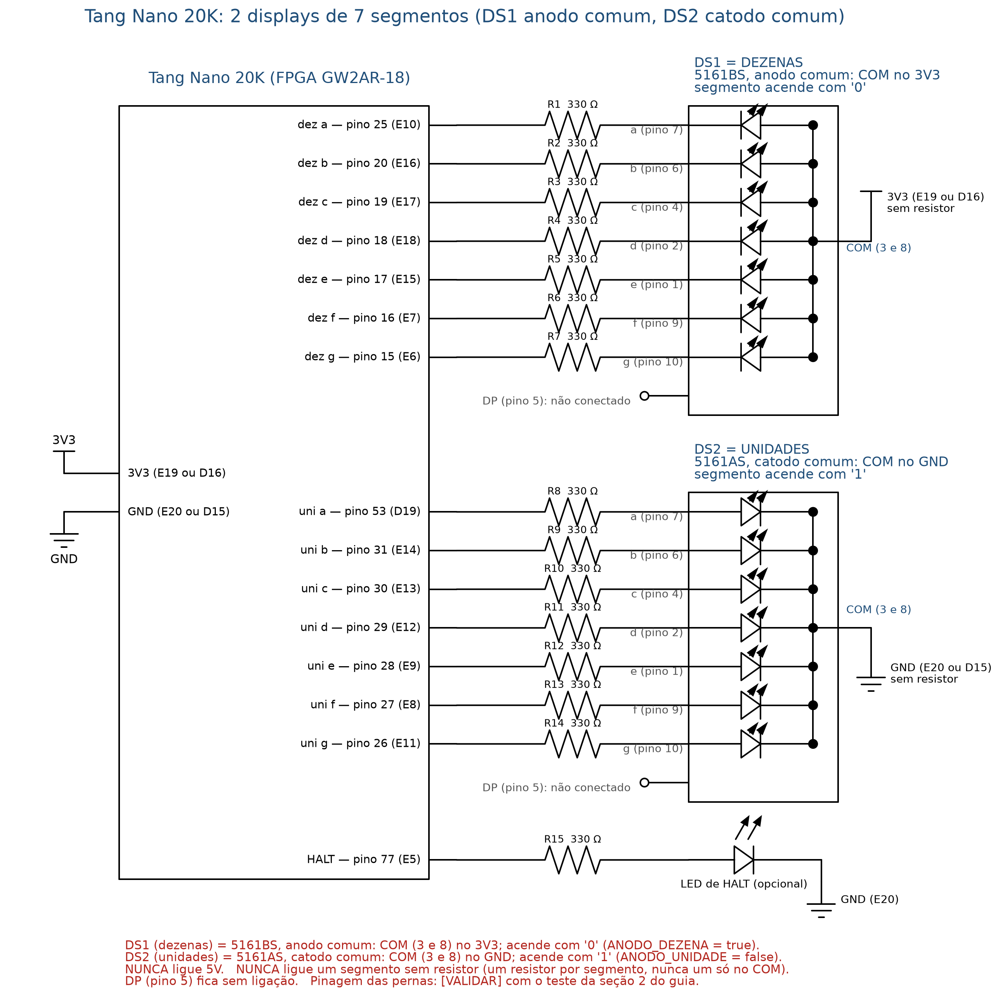
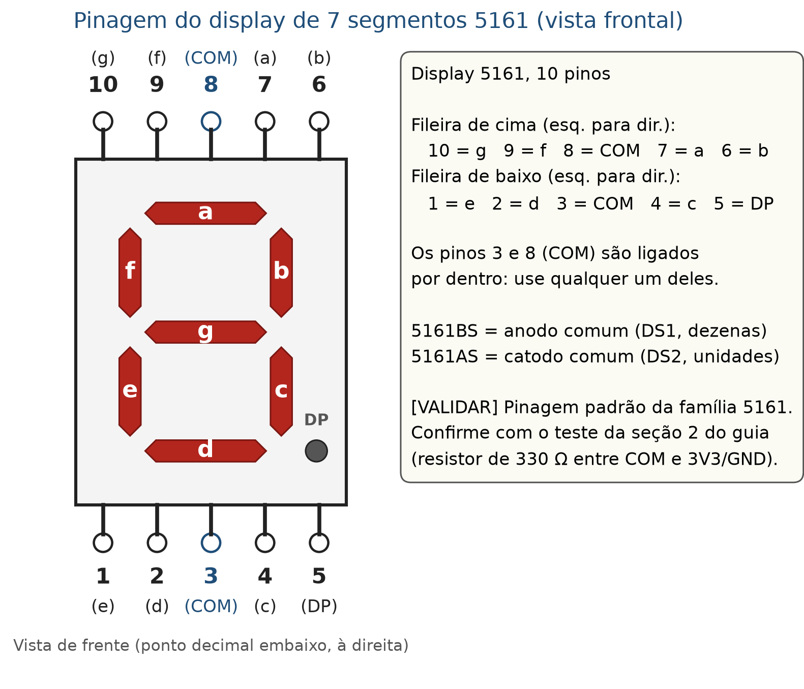

# Primos nos displays: processador na Tang Nano 20K

Extra de FPGA do Lab 7. Segundo o professor, o que vale nota é mostrar os números primos nos displays usando o nosso próprio processador VHDL. O processador roda o crivo da ROM padrão (`micro_processador/rom.vhd`). Cada primo que ele escreve em `r7` aparece em decimal em dois displays de 7 segmentos e fica parado cerca de 1,5 s. No fim o processador executa HALT, o 31 fica parado no display e o botão S1 reinicia.

Placa: Sipeed Tang Nano 20K (FPGA Gowin GW2AR-LV18QN88C8/I7, clock de 27 MHz no pino 4). A pinagem dos segmentos, os parâmetros elétricos e o reset são os mesmos do projeto do veterano, que funcionou na apresentação dele.

## 1. Como o projeto está organizado

```
fpga/
  sincronizar.sh                 copia os 13 VHDL do processador para src/processador/
  tang_nano_20k/
    primos.gprj                  projeto Gowin (abre no Gowin EDA)
    fluxo_aberto.sh              gera o primos.fs sem o Gowin (oss-cad-suite) e, com "gravar", grava na SRAM
    impl/primos_process_config.json   config do Gowin: VHDL 1993, top = top_primos, saída primos.fs
    src/top_primos.vhd           topo: relogio + processador + display_7seg
    src/relogio.vhd              divisor 27 MHz -> 2 kHz e pausa de 1,5 s a cada mudança de r7
    src/display_7seg.vhd         r7 em decimal (0..99), dezena apagada se < 10, "--" se >= 100
    src/pinout.cst               pinos (iguais aos do veterano + LED de halt)
    src/processador/             cópias versionadas, atualizadas pelo sincronizar.sh
    tb/                          testbench do topo, processador-dublê e run_tb.sh
```

Como cada bloco funciona:

- `relogio`: conta ciclos de 27 MHz e inverte um flip-flop a cada 6750 ciclos, o que dá o clock do processador de 27e6 / (2 x 6750) = 2000 Hz. Como cada instrução leva 2 clocks, são 1000 instruções/s e o crivo (algumas centenas de instruções) termina em menos de 1 s. No instante em que vai inverter o clock, o `relogio` lê `r7_out`, que está estável há meio período. Se o valor mudou, ele guarda o novo valor (é o que vai para o display) e congela o clock do processador por 40.500.000 ciclos, ou seja, 1,5 s. Tudo é síncrono a 27 MHz. Os valores são os generics `DIV_MAX` = 6749 e `PAUSA_MAX` = 40499999, e o testbench usa valores pequenos.
- `display_7seg`: separa dezena e unidade por comparações (`>= 90`, `>= 80`...). A polaridade é separada por dígito: `ANODO_DEZENA` (padrão true, 5161BS, segmento aceso em '0') e `ANODO_UNIDADE` (padrão false, 5161AS, aceso em '1'). Com dois displays do mesmo tipo, ajuste os dois generics em `src/top_primos.vhd`.
- `top_primos`: usa o `processador` com a interface congelada da spec (`r7_out`, `halted`). A saída `halted` vai para o pino 77, onde dá para ligar um LED opcional. O clock do processador passa por um `BUFG` (rede global de clock); sem ele o nextpnr acusa violação de hold.

## 2. Material

| Item | Qtde | Observação |
|---|---|---|
| Tang Nano 20K + cabo USB-C **de dados** | 1 | emprestada |
| Display de 7 segmentos, 1 dígito, 10 pinos, vermelho | 2 | DS1 (dezenas) = 5161BS, **anodo comum**; DS2 (unidades) = 5161AS, **catodo comum** (modelos conferidos na foto de 2026-11-20) |
| Resistor 330 ohms | 14 | um por segmento (nos dois displays), nunca um só no comum |
| LED comum + resistor 330 ohms | 1 + 1 | opcional, indicador de HALT |
| Protoboard | 1 | a placa encaixa no meio, um header de cada lado do canal |
| Jumpers macho-macho | ~20 | |

Por que vermelho: o 3V3 menos a queda do LED vermelho (~1,9 V) dá cerca de (3,3 - 1,9) / 330 = 4 mA por segmento, bem abaixo dos 8 mA do `DRIVE=8`. Displays azuis ou brancos (~3 V) ficam fracos ou apagados em 3,3 V. Os pinos 15 a 20 (dezenas) também acendem os LEDs 0 a 5 da placa, então a carga nesses pinos é um pouco maior e as dezenas podem brilhar um pouco menos; não há risco [VALIDAR].

### Como descobrir o tipo (anodo ou catodo) e a pinagem de cada display

Pinagem esperada do 5161 (vista de frente, ponto decimal embaixo à direita): fileira de baixo, da esquerda para a direita, 1 = e, 2 = d, 3 = COM, 4 = c, 5 = DP; fileira de cima, da esquerda para a direita, 10 = g, 9 = f, 8 = COM, 7 = a, 6 = b. Os pinos 3 e 8 (COM) são ligados por dentro [VALIDAR com o teste abaixo]. Veja o desenho em [`esquematico/pinagem_display.png`](esquematico/pinagem_display.png).

Faça o teste com a placa só alimentada pelo USB, usando o 3V3 e o GND do header, **um display de cada vez**. Você precisa de um resistor de 330 ohms e de dois jumpers:

1. Ligue o pino **3** (COM) no **3V3** (E19). Pegue o resistor de 330 ohms, ligue uma ponta no **GND** (E20) e encoste a outra ponta, uma de cada vez, nos pinos 1, 2, 4, 5, 6, 7, 9 e 10. Anote qual segmento acende em cada pino. Se acenderem, o display é **anodo comum** (caso do 5161BS).
2. Se **nada** acender com nenhum pino, inverta: ligue o pino 3 no **GND** (E20) e a ponta livre do resistor no **3V3** (E19), encostando de novo em cada pino. Se acenderem, o display é **catodo comum** (caso do 5161AS).
3. Compare o que você anotou com a pinagem esperada acima (7 = a, 6 = b, 4 = c, 2 = d, 1 = e, 9 = f, 10 = g, 5 = DP). Se algum segmento estiver em outro pino, corrija a coluna "Pino do display" da seção 3 antes de montar.
4. Se o pino 3 não acender nada e o 8 sim (ou ao contrário), use o que funcionar como COM e anote [VALIDAR].

Nunca ligue 5V e nunca ligue um segmento sem o resistor. O tipo de cada display define onde o COM é ligado e qual nível acende o segmento (veja a seção 8 e a seção 3).

## 3. Ligação

Posição no header: conte a partir do USB-C (o topo da placa). Com o USB-C para cima e os chips à vista, o header **E** (esquerdo) e o **D** (direito) têm 20 pinos cada. Os pinos 15 a 20 da FPGA também são os LEDs LED0..LED5 da placa. Eles acendem junto com os segmentos da dezena, o que é normal e até ajuda a depurar.

Esquemático elétrico completo (gerado por `docs/esquematico/gerar_esquematico.py` a partir do `pinout.cst`, em [SVG](esquematico/esquematico_displays.svg)):



Pinagem do display (vista frontal), [VALIDAR] com o teste da seção 2:



### Display da esquerda = DEZENAS (`seg_dezena`), DS1 = 5161BS (anodo comum)

| Segmento | Pino FPGA | Header (lado, posição) | Resistor | Pino do display |
|---|---|---|---|---|
| a | 25 | E10 | R1 330 | 7 |
| b | 20 | E16 | R2 330 | 6 |
| c | 19 | E17 | R3 330 | 4 |
| d | 18 | E18 | R4 330 | 2 |
| e | 17 | E15 | R5 330 | 1 |
| f | 16 | E7  | R6 330 | 9 |
| g | 15 | E6  | R7 330 | 10 |
| comum (anodo) | 3V3 | E19 (ou D16) | sem resistor | 3 e 8 |

### Display da direita = UNIDADES (`seg_unidade`), DS2 = 5161AS (catodo comum)

| Segmento | Pino FPGA | Header (lado, posição) | Resistor | Pino do display |
|---|---|---|---|---|
| a | 53 | **D19** | R8 330 | 7 |
| b | 31 | E14 | R9 330 | 6 |
| c | 30 | E13 | R10 330 | 4 |
| d | 29 | E12 | R11 330 | 2 |
| e | 28 | E9  | R12 330 | 1 |
| f | 27 | E8  | R13 330 | 9 |
| g | 26 | E11 | R14 330 | 10 |
| comum (catodo) | GND | E20 (ou D15) | sem resistor | 3 e 8 |

O ponto decimal (DP, pino 5) fica desligado nos dois displays. No DS1 (anodo comum) o segmento acende com o pino da FPGA em '0'; no DS2 (catodo comum) acende com '1'. Em ambos o resistor de 330 ohms fica em série com cada segmento.

### Opcional: LED de HALT

Ligue o pino 77 (E5) a um resistor de 330 ohms, depois ao anodo do LED (perna longa), e o catodo (perna curta) ao GND (E20). O LED acende quando o processador executa HALT. Escolhi o pino 77 porque na placa ele só vai ao conector FPC do LCD (`LCD_CLK`). Sem LCD conectado ele fica livre, e o exemplo oficial da Sipeed (`rgb_lcd`) já o usa como saída comum. [VALIDAR na placa]

### Header completo (referência)

```
 Esquerdo (E)                 USB-C                  Direito (D)
 pos pino                    +-----+                 pino pos
  1   73                     |     |                  5V   1
  2   74                S1 [ ]     [ ] S2             GND  2
  3   75                                               76  3
  4   85                                               80  4
  5   77  -> LED halt (opc.)                           42  5
  6   15  -> dez g   (LED0)                            41  6
  7   16  -> dez f   (LED1)                            56  7
  8   27  -> uni f                                     54  8
  9   28  -> uni e                                     51  9
 10   25  -> dez a                                     48 10
 11   26  -> uni g                                     55 11
 12   29  -> uni d                                     49 12
 13   30  -> uni c                                     86 13
 14   31  -> uni b                                     79 14  (WS2812)
 15   17  -> dez e   (LED2)                           GND 15
 16   20  -> dez b   (LED5)                           3V3 16
 17   19  -> dez c   (LED4)                            72 17
 18   18  -> dez d   (LED3)                            71 18
 19  3V3  -> comum DS1 (anodo)              uni a  <-   53 19
 20  GND  -> comum DS2 (catodo) e LED halt         52 20
                              HDMI
```

### Esquema de um segmento (vale para os 14)

```
 pino FPGA ---[ 330 ohms ]---|<|--- (segmento)        anodo comum do display --- 3V3
                         catodo do segmento  ...  todos os anodos juntos no comum

 segmento acende quando o pino vai a '0' (3V3 -> LED -> resistor -> pino em 0 V)

        a
      -----          vetor no VHDL: (6)=g (5)=f (4)=e (3)=d (2)=c (1)=b (0)=a
   f |     | b
     |  g  |         ex.: "2" -> a,b,g,e,d acesos -> "0100100"
      -----
   e |     | c
     |     |
      -----
        d
```

## 4. Instalar o Gowin EDA (Windows)

1. Crie uma conta e faça login em https://www.gowinsemi.com (Support > Download). O download exige login.
2. Baixe o **Gowin EDA Education** para Windows, versão 1.9.8 ou mais nova (a Sipeed exige "Gowin IDE Version > 1.9.8"). A edição Education é gratuita, não precisa de licença e, segundo o wiki da Sipeed, suporta o GW2AR-LV18 da Tang Nano 20K [VALIDAR na lista de dispositivos da versão baixada]. A Standard exige licença.
3. Instale com as opções padrão.
4. Programmer: a Sipeed recomenda não usar o Programmer que vem com o IDE. Baixe o deles em https://dl.sipeed.com/shareURL/TANG/programmer, extraia e substitua a pasta `Programmer` da instalação do Gowin pela extraída.

Alternativa Linux: existe Gowin EDA para Linux na mesma página de download. Extraia e rode `IDE/bin/gw_ide` (dê `chmod +x` se não abrir). Não testei no WSL [VALIDAR]. O caminho recomendado é usar o IDE no Windows e gravar pelo WSL ou pelo Programmer do Windows.

## 5. Gerar o bitstream

1. No WSL, na raiz do repositório, copie o processador para dentro do projeto:

   ```bash
   sh fpga/sincronizar.sh
   ```

   O script deve terminar com `OK`. Se aparecer `AVISO: FALTA ...ram.vhd` ou `processador.vhd nao tem a porta 'r7_out'`, o processador ainda não está na versão do Lab 7 (interface com `r7_out` e `halted`). Atualize `micro_processador/` e rode de novo. Toda vez que mudar o processador ou a ROM, rode o script de novo antes de sintetizar.

2. (Recomendado) Copie o projeto para uma pasta do Windows, porque o Gowin pode não lidar bem com caminhos `\\wsl.localhost\...`:

   ```bash
   mkdir -p /mnt/c/Users/sergi/Documents/fpga_primos
   cp -r fpga/tang_nano_20k/. /mnt/c/Users/sergi/Documents/fpga_primos/
   ```

3. No Gowin: **File > Open > `C:\Users\sergi\Documents\fpga_primos\primos.gprj`**. O dispositivo (GW2AR-LV18QN88C8/I7), o VHDL 1993 e o top `top_primos` já vêm configurados.
4. Na aba **Process**, clique duas vezes em **Synthesize** e depois em **Place & Route**. Os dois precisam ficar verdes.
5. O resultado fica em **`impl/pnr/primos.fs`**. O relatório de pinos fica em `impl/pnr/primos.pin.html` e serve para conferir a tabela da seção 3.

Avisos esperados: o clock do processador vem de lógica (flip-flop), por isso o `top_primos` o passa por um `BUFG`. No fluxo aberto isso foi testado; no Gowin, confira se ele aceita o componente `BUFG` sem erro [VALIDAR].

### Alternativa testada: fluxo aberto no WSL, sem o Gowin

Foi o caminho da primeira gravação (2026-11-20). Instale o oss-cad-suite (versão `linux-x64` de https://github.com/YosysHQ/oss-cad-suite-build/releases) extraído em `~/.local/opt/oss-cad-suite`, sem sudo. Depois do passo 1 acima, `sh fpga/tang_nano_20k/fluxo_aberto.sh` gera `fpga/tang_nano_20k/build_aberto/primos.fs` (yosys + ghdl, nextpnr-himbaechel, gowin_pack; os logs ficam na mesma pasta). Com `sh fpga/tang_nano_20k/fluxo_aberto.sh gravar` ele também grava na SRAM, desde que a placa esteja anexada ao WSL (seção 6, opção A).

## 6. Gravar na SRAM (NUNCA na flash)

Grave sempre na **SRAM**. A gravação some quando a placa perde energia, e é isso que queremos com uma placa emprestada: ao desligar, ela volta ao que o dono tinha gravado na flash. Não use "External Flash", "exFlash Erase, Program" nem `openFPGALoader -f`. Depois de desconectar o USB é preciso gravar de novo.

### Opção A: WSL com openFPGALoader

Conferido: o pacote `openfpgaloader` do Ubuntu 24.04 é a versão 0.12.0 e lista a placa como `tangnano20k` (cabo `ft2232`, emulado pelo BL616 da placa). O padrão é `--write-sram`.

No **PowerShell como administrador** (Windows), uma vez só:

```powershell
winget install --interactive --exact dorssel.usbipd-win
```

Com a placa conectada e um terminal do WSL aberto:

```powershell
usbipd list
usbipd bind --busid <BUSID>
usbipd attach --wsl --busid <BUSID>
```

`<BUSID>` é o da linha da placa no `usbipd list` (na placa emprestada: `1-6`, "USB Debugger", VID:PID `0403:6010`). O `bind` é feito uma vez só, como admin; se o PowerShell foi aberto antes da instalação, use o caminho completo `& "C:\Program Files\usbipd-win\usbipd.exe"`. Se a placa aparecer como `Unknown USB Device (Device Descriptor Request Failed)`, desconecte e reconecte direto no notebook. O `attach` precisa ser repetido toda vez que a placa for reconectada e não exige admin.

No WSL:

```bash
sudo apt install openfpgaloader
lsusb
openFPGALoader -b tangnano20k --detect
openFPGALoader -b tangnano20k -m /mnt/c/Users/sergi/Documents/fpga_primos/impl/pnr/primos.fs
```

O `--detect` deve mostrar `idcode 0x81b`, `Gowin`, `GW2A(R)-18(C)`. Com o fluxo aberto, o arquivo é `fpga/tang_nano_20k/build_aberto/primos.fs`.

Se der `Access denied (insufficient permissions)` (ou `LIBUSB_ERROR_ACCESS`), crie uma vez a regra udev num terminal Ubuntu de verdade (o `sudo` pede senha e não funciona pelo `!` do Claude Code):

```bash
echo 'SUBSYSTEM=="usb", ATTRS{idVendor}=="0403", ATTRS{idProduct}=="6010", MODE="0664", GROUP="plugdev"' | sudo tee /etc/udev/rules.d/99-tangnano20k.rules && sudo udevadm control --reload-rules && sudo udevadm trigger
```

O usuário precisa estar no grupo `plugdev` (`id` mostra). Na máquina do Sergio a regra já foi criada em 2026-11-20.

Para devolver a placa ao Windows: `usbipd detach --busid <BUSID>`. Enquanto ela estiver anexada ao WSL, o Programmer do Windows não a enxerga.

### Opção B: Windows com o Programmer (o recomendado pela Sipeed)

1. Abra o Programmer (pelo Gowin: **Tools > Programmer**, ou o executável da pasta substituída).
2. Clique em **Scan Device**. Deve aparecer GW2AR-18C.
3. Na linha do dispositivo, em Operation, escolha **Access Mode = SRAM Mode** e **Operation = SRAM Program**. Em File name, selecione `impl\pnr\primos.fs`.
4. Clique em **Program/Configure**.
5. Se falhar ou ficar lento, reduza a frequência do cabo para 2,5 MHz ou menos e não escolha operações com "Verify" (dica do wiki da Sipeed).

## 7. Comportamento esperado

1. Logo após gravar, o display mostra ` 0` (dezena apagada, unidade 0) por menos de 1 s, enquanto o crivo monta a tabela na RAM.
2. Depois aparecem 2, 3, 5, 7, 11, 13, 17, 19, 23, 29, 31, cada um por cerca de 1,5 s (abaixo de 10 a dezena fica apagada). Os LEDs 0 a 5 da placa piscam junto com a dezena.
3. O 31 fica parado e o LED de halt (se estiver ligado) acende. O processador executou HALT.
4. Apertar **S1** (botão ao lado do USB-C, à esquerda) volta ao passo 1. O ciclo completo leva cerca de 17 s.

Simulação antes de ir para a placa (no WSL, com `ghdl` no PATH):

```bash
sh fpga/tang_nano_20k/tb/run_tb.sh          # usa src/processador/ se existir, senão o dublê
sh fpga/tang_nano_20k/tb/run_tb.sh duble    # força o processador-dublê
sh fpga/tang_nano_20k/tb/run_tb.sh real     # exige src/processador/ completo (rode sincronizar.sh)
```

O testbench confere os códigos de 7 segmentos (2, 7, 13, 31), a pausa a cada mudança de r7, que o display fica em 31 depois do HALT e que o reset reinicia. A saída termina em `OK`.

## 8. Solução de problemas

| Sintoma | Causa provável | O que fazer |
|---|---|---|
| Nada acende, nem os LEDs 0 a 5 da placa | não gravou, ou gravou e a placa perdeu energia | grave de novo (SRAM some ao desligar); confira se o Programmer/openFPGALoader terminou sem erro |
| LEDs da placa piscam mas os displays não | comum no lugar errado (DS1 5161BS no 3V3, DS2 5161AS no GND) ou resistores/jumpers fora do lugar | confira o comum de cada display; faça o teste da seção 2 |
| Aparece o "negativo" do número (acende o que deveria apagar) | o generic daquele dígito não bate com o tipo do display (`ANODO_DEZENA`/`ANODO_UNIDADE` = true é anodo comum, false é catodo comum) | confira o código do display (5161**B**S = anodo, 5161**A**S = catodo) e o comum (anodo no 3V3, catodo no GND); ajuste o generic em `src/top_primos.vhd`, sintetize e grave de novo |
| Fica em ` 0` e só anda enquanto S1 está apertado | reset invertido | não esperado: o veterano e os exemplos da Sipeed (`sys_resetn <= ~s1`) mostram S1 = '1' quando apertado. Se acontecer, em `top_primos.vhd` crie `signal rst_int : std_logic;`, faça `rst_int <= not rst;` e ligue `rst => rst_int` no `relogio` e no `processador` [VALIDAR] |
| Um dígito fica estranho (ex.: 7 parece 1, 3 parece 9) | um segmento no pino errado ou trocado com outro | compare com a tabela da seção 3 e com `impl/pnr/primos.pin.html`; teste cada segmento com o "teste do display" da seção 2 |
| Mostra `--` | r7 >= 100 ou negativo: o processador escreveu um valor errado em r7 | rode `sh micro_processador/run.sh` e `run_tb.sh real` e confira a sequência de r7 |
| Fica em ` 0` para sempre | o processador não escreve em r7 (ROM errada, erro no crivo) ou não recebe clock | simulação `run_tb.sh real`; confira se o `rom.vhd` copiado é o do crivo |
| O 31 não aparece e o LED de halt não acende | crivo não chega ao HALT | simulação do processador (`micro_processador/run.sh`) |
| Gowin: arquivo `src/processador/...` não encontrado | não rodou `sincronizar.sh`, ou a cópia para o Windows foi feita antes | rode o script e copie de novo |
| Gowin: porta `r7_out`/`halted` não existe | `processador.vhd` ainda com a interface antiga | atualize o processador (spec do Lab 7) |
| Gowin acusa o pino 77 (dual-purpose ou conflito) | configuração do pino | troque `77` por `48` no `pinout.cst` (D10, `LCD_DE`, também só vai ao FPC) [VALIDAR] |
| Programmer: "cable open failed" ou não acha o dispositivo | Programmer errado, cabo só de energia, placa anexada ao WSL | use o Programmer da Sipeed, troque o cabo, `usbipd detach` |
| nextpnr: `Hold/min time violation for clock 'posedge clk_proc'` | clock do processador fora da rede global | mantenha o `BUFG` do `top_primos.vhd` |
| openFPGALoader: `Access denied (insufficient permissions)` | falta a regra udev de `0403:6010` | regra da seção 6, opção A |
| openFPGALoader não acha a placa no WSL | `usbipd attach` não foi feito (precisa refazer a cada reconexão) | `usbipd list` deve mostrar "Attached"; `lsusb` no WSL deve listar `0403:6010` |
| Displays muito fracos | display azul/branco ou resistor maior | use display vermelho; não reduza o resistor abaixo de 220 ohms |

## 9. Referências

- Datasheet Tang Nano 20K v1.3 (pinagem na página 5).
- Wiki Sipeed, instalação do IDE: https://wiki.sipeed.com/hardware/en/tang/Tang-Nano-Doc/install-the-ide.html
- Wiki Sipeed, perguntas frequentes (Programmer, SRAM/flash): https://wiki.sipeed.com/hardware/en/tang/common-doc/questions.html
- Exemplos oficiais da Tang Nano 20K (S1 no pino 88, pino 77 como `LCD_CLK`): https://github.com/sipeed/TangNano-20K-example
- usbipd-win no WSL (Microsoft): https://learn.microsoft.com/en-us/windows/wsl/connect-usb
- openFPGALoader: https://trabucayre.github.io/openFPGALoader/
