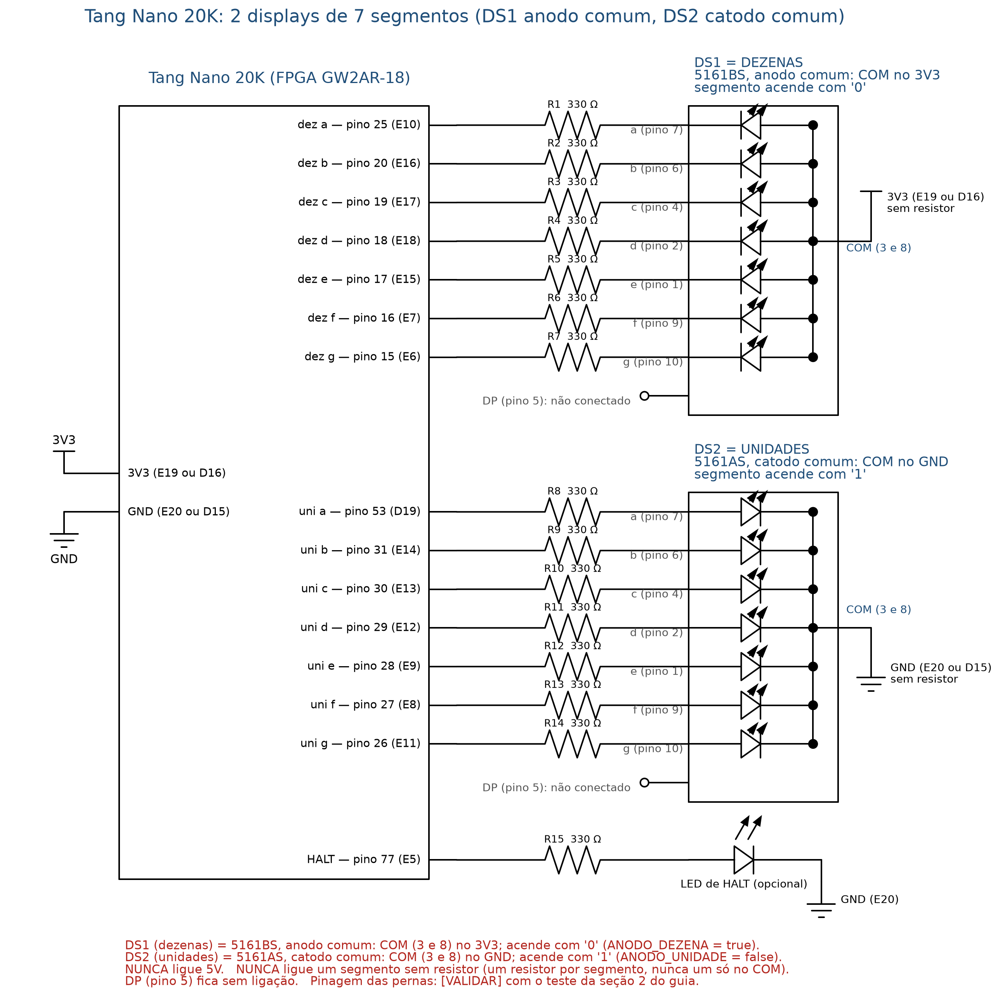
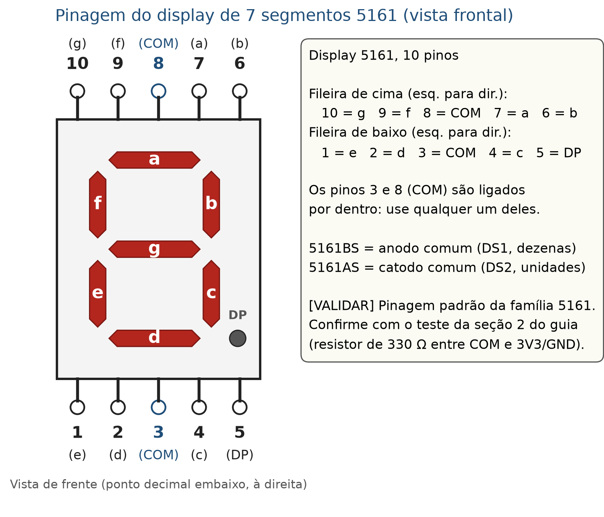
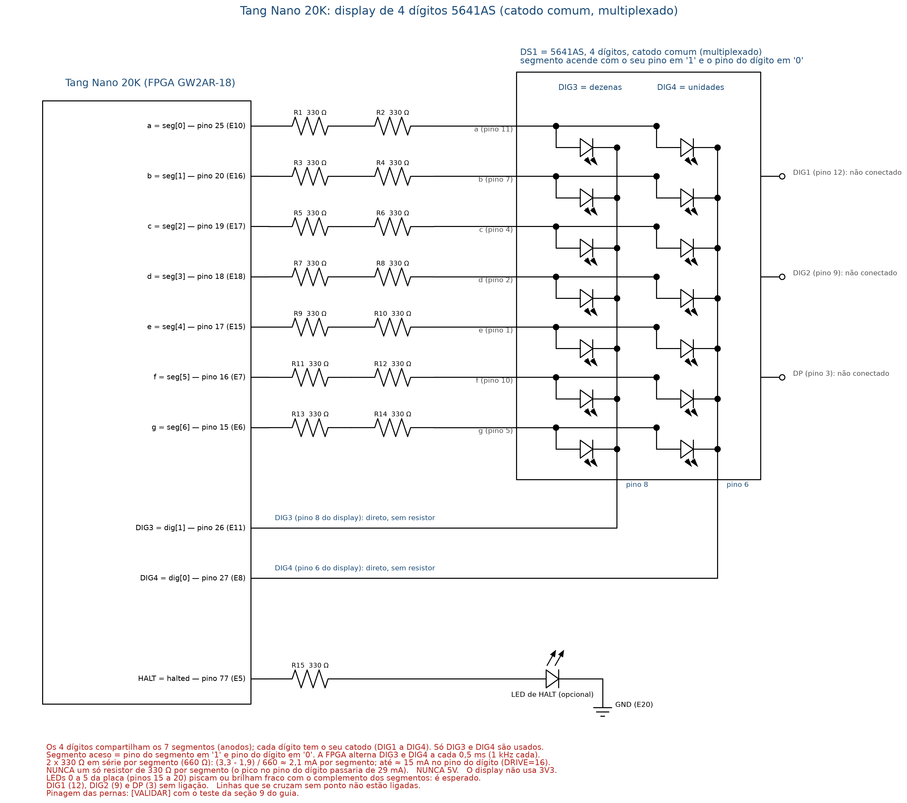
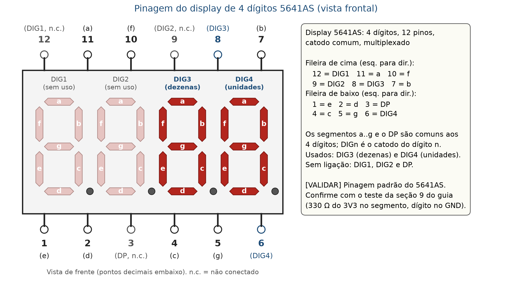

# Para quem é este guia

Este guia é para quem sabe VHDL, mas nunca montou este ambiente. Ele parte de um PC com Windows 10 ou 11 e termina com o processador do Lab 7 rodando na Sipeed Tang Nano 20K, mostrando os números primos em displays de 7 segmentos.

O caminho é o mesmo que já foi testado na máquina do Sergio:

1. instalar o Ubuntu dentro do Windows (WSL2);
2. instalar um pacote de ferramentas abertas de FPGA (oss-cad-suite), sem o Gowin EDA;
3. clonar o repositório e rodar as simulações, sem placa;
4. passar a placa do Windows para o Ubuntu (usbipd);
5. gerar o bitstream e gravá-lo na SRAM da placa;
6. montar os displays na protoboard.

Itens marcados com **[VALIDAR]** não foram testados num PC diferente do do Sergio. Se algo der diferente, anote o que apareceu e avise a equipe.

> **Regra da placa emprestada.** A Tang Nano 20K é do Vinícius. Grave **somente na SRAM**, que apaga quando a placa perde energia. Nunca use `openFPGALoader -f` nem qualquer opção com "flash" ou "External Flash". O script deste guia já grava só na SRAM.

# Glossário rápido

FPGA
:   Chip com lógica reconfigurável. Em vez de executar um programa, ele vira o circuito descrito em VHDL. A Tang Nano 20K usa a FPGA Gowin GW2AR-18.

Bitstream (`.fs`)
:   Arquivo que configura a FPGA, resultado de todo o fluxo de síntese. Na Gowin a extensão é `.fs`. Aqui ele se chama `primos.fs` (ou `primos_4dig.fs`).

SRAM x flash
:   A FPGA guarda a configuração numa memória SRAM interna, que apaga quando a energia acaba. A placa também tem uma flash, que guarda um bitstream permanente e é carregada ao ligar. Gravar na SRAM é temporário e não mexe no que o dono deixou na flash. Por isso só gravamos na SRAM.

WSL2
:   Windows Subsystem for Linux, versão 2. Roda um Ubuntu de verdade dentro do Windows. As ferramentas abertas de FPGA e os scripts do repositório são para Linux, por isso usamos o WSL2.

oss-cad-suite
:   Pacote pronto da YosysHQ com todas as ferramentas abertas de FPGA, já compiladas. Não precisa de `sudo` para instalar: é só extrair numa pasta. As ferramentas que usamos:

    - **yosys**: síntese. Transforma o VHDL em uma rede de portas e flip-flops da família Gowin.
    - **ghdl**: simulador de VHDL. Também é o "leitor" de VHDL do yosys (o plugin `-m ghdl`), porque o yosys sozinho só entende Verilog.
    - **nextpnr-himbaechel**: posicionamento e roteamento (place and route). Decide onde cada elemento fica no chip e liga os fios, respeitando os pinos do arquivo `.cst`.
    - **gowin_pack**: converte o resultado do nextpnr no bitstream `.fs`.
    - **openFPGALoader**: envia o `.fs` para a placa pelo USB.
    - **gtkwave**: visualizador de formas de onda das simulações.

usbipd
:   Programa do Windows (usbipd-win) que "empresta" um dispositivo USB ao WSL. Sem ele o Ubuntu não enxerga a placa, porque o USB pertence ao Windows.

udev
:   Parte do Linux que cria os arquivos de dispositivo quando algo é conectado e decide quem pode acessá-los. Uma regra udev permite que o seu usuário use a placa sem `sudo`.

# O que baixar

| Item | Onde | Para quê |
|-------------|------------------------------|------------------------------------------|
| Ubuntu 24.04 no WSL2 | comando `wsl --install` no PowerShell | ambiente Linux onde tudo roda |
| git, python3, zlib1g-dev | `apt` dentro do Ubuntu | clonar o repositório, rodar o montador e permitir que o ghdl do oss-cad-suite gere executáveis |
| oss-cad-suite linux-x64 (testada: 20261120) | <https://github.com/YosysHQ/oss-cad-suite-build/releases> | síntese, simulação, place and route, bitstream e gravação |
| usbipd-win (testada: 5.3.0) | `winget` no PowerShell | passar a placa USB do Windows para o WSL |
| Repositório ArqComp | GitHub `thalesromagna/ArqComp`, branch `lab7-validacao` (clone por SSH) | VHDL, scripts, programas e testbenches |
| Cabo USB-C **de dados** | (material físico) | cabo só de carga não serve: a placa não aparece |

# Instalação passo a passo (Windows 10/11 + WSL2)

## Instalar o WSL2 com Ubuntu

Por quê: as ferramentas e os scripts (`.sh`) são de Linux. O WSL2 dá um Ubuntu completo sem dual boot.

Abra o **PowerShell como administrador** (menu Iniciar, digite "PowerShell", botão direito, "Executar como administrador") e rode:

```powershell
wsl --install -d Ubuntu-24.04
```

[VALIDAR] o nome da distribuição: se o comando reclamar, rode `wsl --list --online` e use o nome exato da linha do Ubuntu 24.04. O Windows 10 precisa estar atualizado (versão 2004 ou mais nova) e a virtualização precisa estar ativada na BIOS [VALIDAR].

Reinicie o PC se ele pedir. Na primeira abertura do Ubuntu (menu Iniciar, "Ubuntu 24.04"), ele pede um nome de usuário e uma senha. Guarde a senha: é ela que o `sudo` vai pedir.

## Pacotes do Ubuntu

Por quê: `git` clona o repositório; `python3` roda o montador e os testes dele; `zlib1g-dev` é uma biblioteca de que o ghdl do oss-cad-suite precisa para gerar o executável da simulação. Sem ela a simulação falha com `/usr/bin/ld: cannot find -lz`.

No terminal do Ubuntu:

```bash
sudo apt update
sudo apt install -y git python3 zlib1g-dev
```

## Git e chave SSH

Por quê: o repositório é acessado por SSH (`git@github.com:...`), que usa um par de chaves em vez de senha ou token. A chave pública vai para o GitHub; a privada nunca sai do seu PC.

```bash
git config --global user.name "Seu Nome"
git config --global user.email "seu-email-do-github@exemplo.com"
ssh-keygen -t ed25519 -C "seu-email-do-github@exemplo.com"
cat ~/.ssh/id_ed25519.pub
```

No `ssh-keygen`, aceite o caminho padrão com Enter (a senha da chave é opcional). Copie a linha inteira mostrada pelo `cat` e cadastre em GitHub, **Settings > SSH and GPG keys > New SSH key**. Depois teste:

```bash
ssh -T git@github.com
```

Na primeira vez ele pergunta se confia no servidor: responda `yes`. Deve aparecer uma saudação com o seu usuário do GitHub.

## Clonar o repositório

Por quê clonar dentro do Ubuntu (`~`) e não em `C:\`: o acesso a arquivos do Windows pelo WSL (`/mnt/c/...`) é bem mais lento e confunde permissões de execução dos scripts.

```bash
mkdir -p ~/repositorios
cd ~/repositorios
git clone git@github.com:thalesromagna/ArqComp.git
cd ArqComp
git checkout lab7-validacao
```

Daqui em diante, todo comando do guia é rodado a partir de `~/repositorios/ArqComp` (a raiz do repositório).

## oss-cad-suite

Por quê esta forma: o pacote vem pronto, então basta baixar e extrair numa pasta do seu usuário (`~/.local/opt`), sem `sudo` e sem mexer no sistema. O script de gravação procura as ferramentas exatamente em `~/.local/opt/oss-cad-suite`.

Na página de releases (<https://github.com/YosysHQ/oss-cad-suite-build/releases>), procure o arquivo `oss-cad-suite-linux-x64-AAAAMMDD.tgz`. A versão testada é a de 2026-11-20. Copie o link do arquivo (botão direito, "Copiar endereço do link") e use no `wget`:

```bash
mkdir -p ~/.local/opt
cd ~/.local/opt
URL=https://github.com/YosysHQ/oss-cad-suite-build/releases/download
wget $URL/2026-11-20/oss-cad-suite-linux-x64-20261120.tgz
tar -xzf oss-cad-suite-linux-x64-20261120.tgz
ls ~/.local/opt/oss-cad-suite
```

A variável `URL` só encurta a linha. [VALIDAR] o link segue o padrão das releases; se der erro 404, rode `wget` com o link copiado da página. O arquivo é grande, então o download pode demorar. O `tar` cria a pasta `oss-cad-suite`, e o `ls` deve mostrar, entre outros, `bin`, `environment` e `VERSION`. Depois de extrair, o `.tgz` pode ser apagado.

Para usar as ferramentas num terminal, ative o ambiente (vale só para aquele terminal):

```bash
. ~/.local/opt/oss-cad-suite/environment
```

O ponto no início faz o arquivo ser lido pelo próprio terminal, colocando as ferramentas no `PATH`. O script `fluxo_aberto.sh` faz isso sozinho; a ativação manual serve para rodar `ghdl`, `gtkwave` e `openFPGALoader` diretamente.

**Alternativa para simular:** `sudo apt install ghdl` instala o ghdl 4.1 do Ubuntu 24.04, que também foi testado com os scripts de simulação. Ele não serve para a síntese, que usa o ghdl do oss-cad-suite como plugin do yosys.

## usbipd-win (no Windows)

Por quê: a placa é USB e o USB pertence ao Windows. O usbipd-win empresta o dispositivo ao WSL.

No **PowerShell como administrador**:

```powershell
winget install --interactive --exact dorssel.usbipd-win
```

Siga o instalador com as opções padrão. Se o PowerShell já estava aberto antes da instalação, ele não acha o comando `usbipd`; feche e abra de novo, ou use o caminho completo:

```powershell
& "C:\Program Files\usbipd-win\usbipd.exe" list
```

> **O que muda em Linux nativo (sem Windows)**
>
> - Pule o WSL2 e o usbipd-win inteiros: a placa aparece direto no Linux.
> - O resto é igual: pacotes do `apt`, chave SSH, clone, oss-cad-suite em `~/.local/opt` e a regra udev da seção de conexão.
> - Depois de criar a regra udev, desconecte e reconecte a placa.
> - [VALIDAR] não testado em Linux nativo; os comandos de `apt` supõem Ubuntu ou Debian.

# Testar sem a placa

Por quê: antes de gastar tempo com hardware, confirme que o processador e o topo da FPGA estão corretos em simulação. Se a simulação falha, a placa também vai falhar.

## Testes do montador

O montador (`micro_processador/programas/montador.py`) converte os programas `.asm` em ROMs VHDL. Ele usa só o `python3` do Ubuntu:

```bash
cd ~/repositorios/ArqComp
python3 -m unittest discover -s micro_processador/programas -p "test_montador.py"
```

Saída esperada: `Ran 18 tests` e `OK` na última linha.

## Simulação do processador

Os scripts de simulação precisam de um `ghdl` no `PATH`: ative o oss-cad-suite (ou use o ghdl do `apt`).

```bash
. ~/.local/opt/oss-cad-suite/environment
sh micro_processador/run.sh
sh micro_processador/run.sh teste_ram
sh micro_processador/run.sh instrucoes
```

O primeiro roda a ROM padrão (o crivo de Eratóstenes) e compara os valores escritos em `r7` com `programas/crivo.esperado`. A saída deve conter:

```text
ROM: rom.vhd
r7: 2 3 5 7 11 13 17 19 23 29 31
HALTED
esperado: 2 3 5 7 11 13 17 19 23 29 31
OK
```

Os outros dois rodam programas de teste da RAM e de todas as instruções; os dois também terminam em `OK`. Se aparecer `/usr/bin/ld: cannot find -lz`, falta o `zlib1g-dev` (seção de pacotes do Ubuntu).

## Simulação do topo da FPGA

```bash
sh fpga/tang_nano_20k/tb/run_tb.sh real
```

Ele compila o processador real (a cópia em `fpga/tang_nano_20k/src/processador/`) junto com o divisor de clock e os decodificadores de display, e roda 4 testbenches: `display_7seg_tb`, `top_primos_tb`, `display_mux_tb` e `top_primos_4dig_tb`. Eles conferem os códigos de 7 segmentos, a pausa a cada novo primo, que o display para no 31 depois do HALT e que o reset reinicia. A última linha deve ser `OK`.

## Formas de onda (opcional)

```bash
gtkwave micro_processador/processador_tb.ghw micro_processador/processador_tb.gtkw
```

O `.ghw` é gerado pelo `run.sh` e o `.gtkw` guarda os sinais já escolhidos. [VALIDAR] no Windows 11 o WSL abre janelas gráficas sozinho (WSLg); no Windows 10 pode não abrir.

## Se você mudar o processador ou a ROM

```bash
python3 micro_processador/programas/montador.py todos
sh fpga/sincronizar.sh
```

O primeiro regenera as ROMs, os `.lst` e os `.esperado` a partir dos `.asm`. O segundo copia os 13 arquivos VHDL do processador de `micro_processador/` para `fpga/tang_nano_20k/src/processador/`, que é de onde a síntese lê; ele termina com uma linha começando por `OK`. Sem essa cópia, a placa recebe a versão antiga.

# Conectar a placa ao WSL

Por quê tantos passos: o Windows precisa liberar a placa (`bind`, uma vez), anexá-la ao WSL (`attach`, a cada conexão) e o Linux precisa deixar o seu usuário acessá-la (regra udev, uma vez).

## Uma vez só: liberar a placa (bind)

1. Conecte a placa com o cabo USB-C de dados, de preferência direto no PC (sem hub).
2. Deixe um terminal do Ubuntu aberto (o WSL precisa estar rodando).
3. No **PowerShell como administrador**:

```powershell
usbipd list
usbipd bind --busid <BUSID>
```

No `usbipd list`, a placa aparece com VID:PID `0403:6010`, com o nome "USB Debugger" ou "USB Serial Converter A, USB Serial Converter B". O `<BUSID>` é o número da primeira coluna dessa linha (por exemplo `1-6`). Ele pode mudar se você trocar de porta USB; se na nova porta a placa aparecer como "Not shared", rode o `bind` de novo.

Se aparecer "Access denied; this operation requires administrator privileges", o PowerShell não foi aberto como administrador.

Se a placa aparecer como "Unknown USB Device (Device Descriptor Request Failed)", desconecte e reconecte direto no PC; se continuar, troque o cabo (precisa ser cabo de dados).

## A cada conexão: anexar ao WSL (attach)

Num PowerShell comum (não precisa ser administrador), com o Ubuntu aberto:

```powershell
usbipd attach --wsl --busid <BUSID>
```

Repita sempre que desconectar a placa, reiniciar o PC ou reiniciar o WSL. Depois disso, `usbipd list` mostra a placa como "Attached". Para devolvê-la ao Windows: `usbipd detach --busid <BUSID>`.

## Uma vez só: permissão no Linux (regra udev)

Sem esta regra, o openFPGALoader falha com `Error code -3 Access denied (insufficient permissions)`, porque o dispositivo USB pertence ao root. A regra diz ao udev que todo dispositivo `0403:6010` fica acessível ao grupo `plugdev`.

Rode num terminal do Ubuntu (o `sudo` pede a sua senha):

```{=latex}
\begin{Verbatim}[fontsize=\scriptsize]
echo 'SUBSYSTEM=="usb", ATTRS{idVendor}=="0403", ATTRS{idProduct}=="6010", MODE="0664", GROUP="plugdev"' |
  sudo tee /etc/udev/rules.d/99-tangnano20k.rules &&
  sudo udevadm control --reload-rules &&
  sudo udevadm trigger
\end{Verbatim}
```

A primeira linha (do `echo` até o `|`) precisa ficar inteira; ao copiar do PDF, confira que ela não foi partida. São três comandos encadeados: grava a regra num arquivo, recarrega as regras e reaplica aos dispositivos já conectados. Confira se o seu usuário está no grupo `plugdev`:

```bash
id
```

A lista `groups=` deve conter `plugdev`. Se não contiver, `sudo usermod -aG plugdev $USER`, depois feche o Ubuntu e rode `wsl --shutdown` no PowerShell para o grupo valer [VALIDAR]. Depois de criar a regra, refaça o `attach`.

## Conferir a conexão

```bash
. ~/.local/opt/oss-cad-suite/environment
openFPGALoader -b tangnano20k --detect
```

Deve mostrar `idcode 0x81b`, `manufacturer Gowin`, `family GW2A` e `model GW2A(R)-18(C)`. Se aparecer isso, a cadeia toda (cabo, usbipd, udev, ferramenta) está funcionando. O `--detect` só lê a identificação do chip: não grava nada.

# Gerar o bitstream e gravar na SRAM

O script `fpga/tang_nano_20k/fluxo_aberto.sh` faz o fluxo completo: síntese (yosys + ghdl), place and route (nextpnr-himbaechel), bitstream (gowin_pack) e, se pedido, gravação (openFPGALoader). Ele mesmo coloca o oss-cad-suite no `PATH`. Se você extraiu o oss-cad-suite em outra pasta, rode com `OSS_CAD_SUITE=/caminho/da/pasta sh ...`.

Antes de gravar, confira a montagem (seção de montagem) e faça o `attach`.

**Variante de 2 displays separados** (5161BS anodo comum nas dezenas, 5161AS catodo comum nas unidades):

```bash
sh fpga/tang_nano_20k/fluxo_aberto.sh gravar
```

**Variante do display de 4 dígitos** (5641AS):

```bash
sh fpga/tang_nano_20k/fluxo_aberto.sh 4dig gravar
```

Sem a palavra `gravar`, o script só gera o arquivo, sem precisar da placa. O resultado fica em `fpga/tang_nano_20k/build_aberto/` (`primos.fs` ou `primos_4dig.fs`), junto com os logs de cada etapa. A saída mostra as etapas nesta ordem:

```text
== sintese (yosys + ghdl)
== posicionamento e roteamento (nextpnr)
== bitstream (gowin_pack)
gerado: .../fpga/tang_nano_20k/build_aberto/primos.fs
== gravando na SRAM (nao grava na flash)
```

A gravação usa `openFPGALoader -b tangnano20k -m`, em que `-m` significa "escrever na SRAM". **Nunca** troque por `-f` (flash).

Quando a placa perde energia, a SRAM apaga e a placa volta ao projeto que está na flash do Vinícius: um padrão "girando" nos LEDs da placa e no display das dezenas. Isso é normal. Para voltar ao nosso projeto, faça o `attach` e grave de novo.

# Montagem

## Cuidados elétricos

- **Nunca use 5V.** Os displays e a FPGA trabalham em 3,3 V.
- **Nunca ligue um segmento sem resistor.** Cada segmento é um LED; sem resistor a corrente só é limitada pelo pino da FPGA e pode danificá-lo.
- Use displays **vermelhos**: com 3,3 V e 330 ohms dão cerca de 4 mA por segmento. Azuis ou brancos ficam fracos ou apagados.
- Protoboards compridas podem ter os trilhos + e - cortados no meio. Se for usar os trilhos, ligue as duas metades com um jumper.
- Monte com a placa desconectada do USB e confira antes de ligar.

## Posição dos pinos na placa

Com o USB-C para cima e os chips à vista, o header **E** (esquerdo) e o **D** (direito) têm 20 pinos cada, contados a partir do USB-C. "E10" quer dizer header esquerdo, posição 10. Os pinos 15 a 20 da FPGA também acendem os LEDs 0 a 5 da placa, o que é normal.

```text
 Esquerdo (E)                 USB-C                  Direito (D)
 pos pino                    +-----+                 pino pos
  1   73                     |     |                  5V   1
  2   74                S1 [ ]     [ ] S2             GND  2
  3   75                                               76  3
  4   85                                               80  4
  5   77  -> LED halt (opc.)                           42  5
  6   15  -> dez g   (LED0)                            41  6
  7   16  -> dez f   (LED1)                            56  7
  8   27  -> uni f                                     54  8
  9   28  -> uni e                                     51  9
 10   25  -> dez a                                     48 10
 11   26  -> uni g                                     55 11
 12   29  -> uni d                                     49 12
 13   30  -> uni c                                     86 13
 14   31  -> uni b                                     79 14
 15   17  -> dez e   (LED2)                           GND 15
 16   20  -> dez b   (LED5)                           3V3 16
 17   19  -> dez c   (LED4)                            72 17
 18   18  -> dez d   (LED3)                            71 18
 19  3V3  -> comum DS1 (anodo)              uni a  <-   53 19
 20  GND  -> comum DS2 (catodo) e LED halt         52 20
```

(As anotações à direita das setas valem para a variante de 2 displays.)

## Variante A: dois displays separados (5161BS + 5161AS)

Material: Tang Nano 20K e cabo USB-C de dados; um display 5161BS (anodo comum, dezenas, DS1); um 5161AS (catodo comum, unidades, DS2); 14 resistores de 330 ohms (um por segmento); protoboard; cerca de 20 jumpers macho-macho. Opcional: um LED e mais um resistor de 330 ohms para indicar o HALT.

Por que os dois tipos funcionam juntos: no anodo comum (5161**B**S) o comum vai ao 3V3 e o segmento acende com o pino da FPGA em '0'; no catodo comum (5161**A**S) o comum vai ao GND e o segmento acende com '1'. O VHDL já trata cada display com a polaridade certa (generics `ANODO_DEZENA = true` e `ANODO_UNIDADE = false` em `src/top_primos.vhd`).



{width=70%}

**DS1, display da esquerda, DEZENAS, 5161BS (anodo comum)**

| Segmento | Pino FPGA | Header | Resistor | Pino do display |
|---|---|---|---|---|
| a | 25 | E10 | R1 330 | 7 |
| b | 20 | E16 | R2 330 | 6 |
| c | 19 | E17 | R3 330 | 4 |
| d | 18 | E18 | R4 330 | 2 |
| e | 17 | E15 | R5 330 | 1 |
| f | 16 | E7 | R6 330 | 9 |
| g | 15 | E6 | R7 330 | 10 |
| comum (anodo) | 3V3 | E19 (ou D16) | sem resistor | 3 e 8 |

**DS2, display da direita, UNIDADES, 5161AS (catodo comum)**

| Segmento | Pino FPGA | Header | Resistor | Pino do display |
|---|---|---|---|---|
| a | 53 | **D19** | R8 330 | 7 |
| b | 31 | E14 | R9 330 | 6 |
| c | 30 | E13 | R10 330 | 4 |
| d | 29 | E12 | R11 330 | 2 |
| e | 28 | E9 | R12 330 | 1 |
| f | 27 | E8 | R13 330 | 9 |
| g | 26 | E11 | R14 330 | 10 |
| comum (catodo) | GND | E20 (ou D15) | sem resistor | 3 e 8 |

O ponto decimal (pino 5) fica desligado nos dois. LED de HALT opcional: pino 77 (E5), resistor de 330 ohms, perna longa do LED; perna curta no GND (E20). Ele acende quando o processador executa HALT.

Pinagem do 5161 [VALIDAR com um teste antes de montar]: fileira de baixo, da esquerda para a direita, 1 = e, 2 = d, 3 = COM, 4 = c, 5 = DP; fileira de cima, da esquerda para a direita, 10 = g, 9 = f, 8 = COM, 7 = a, 6 = b. Teste rápido, com a placa só no USB e um display por vez: ligue o pino 3 no 3V3 (E19), prenda um resistor de 330 ohms no GND (E20) e encoste a outra ponta em cada pino. Se acender, é anodo comum. Se nada acender, inverta (pino 3 no GND, resistor no 3V3): se acender, é catodo comum.

## Variante B: display de 4 dígitos (5641AS)

Material: um 5641AS (4 dígitos, catodo comum); 14 resistores de 330 ohms, **dois em série por segmento**; cerca de 15 jumpers. Opcional: LED de HALT com mais um resistor.

Por quê: o display de 4 dígitos tem 32 LEDs e só 12 pinos. O segmento "a" dos 4 dígitos é um fio só, e cada dígito tem o seu catodo. A FPGA acende um dígito por vez, alternando dezena e unidade 2000 vezes por segundo (multiplexação); o olho vê os dois acesos. O número aparece nos dois dígitos da direita: DIG3 = dezenas, DIG4 = unidades. Os dois resistores por segmento (660 ohms, cerca de 2,1 mA) limitam a corrente que sai pelo pino do dígito quando os 7 segmentos acendem. **Nunca use um resistor só por segmento nesta variante.**





| Sinal | Pino FPGA | Header | Resistores | Pino do display |
|---|---|---|---|---|
| a | 25 | E10 | R1 + R2 | 11 |
| b | 20 | E16 | R3 + R4 | 7 |
| c | 19 | E17 | R5 + R6 | 4 |
| d | 18 | E18 | R7 + R8 | 2 |
| e | 17 | E15 | R9 + R10 | 1 |
| f | 16 | E7 | R11 + R12 | 10 |
| g | 15 | E6 | R13 + R14 | 5 |
| DIG3 (dezenas) | 26 | E11 | sem resistor | 8 |
| DIG4 (unidades) | 27 | E8 | sem resistor | 6 |
| HALT (LED opcional) | 77 | E5 | R15 330 | LED, depois GND (E20) |
| DIG1, DIG2, DP | - | - | - | 12, 9 e 3: sem ligação |

Pinagem do 5641AS [VALIDAR com um teste antes de montar]: fileira de baixo, da esquerda para a direita, 1 = e, 2 = d, 3 = DP, 4 = c, 5 = g, 6 = DIG4; fileira de cima, da esquerda para a direita, 12 = DIG1, 11 = a, 10 = f, 9 = DIG2, 8 = DIG3, 7 = b. Teste: pino 8 no GND (E20), resistor de 330 ohms no 3V3 (E19) e encoste a outra ponta nos pinos 11, 7, 4, 2, 1, 10, 5 e 3; devem acender a, b, c, d, e, f, g e DP no terceiro dígito. Passe o GND para o pino 6 e repita no quarto dígito.

# O que deve aparecer

Na variante de 2 displays (ciclo completo de cerca de 17 s, cada número fica cerca de 1,5 s):

1. Logo após gravar, o display mostra " 0" (dezena apagada, unidade 0) por menos de 1 s, enquanto o crivo monta a tabela na RAM.
2. Depois 2, 3, 5 e 7, com a dezena apagada.
3. Depois 11, 13, 17, 19, 23 e 29.
4. Para no 31: o processador executou HALT. O LED de HALT, se ligado, acende.
5. O botão **S1** (ao lado do USB-C) reinicia tudo a partir do passo 1.

Na variante de 4 dígitos a sequência é a mesma, nos dois dígitos da direita, um pouco mais fraca por causa da multiplexação.

Por que tão devagar: o processador roda a 2 kHz, derivado dos 27 MHz da placa, e o circuito congela o clock dele por 1,5 s cada vez que `r7` muda, para dar tempo de ler o número.

# Problemas comuns

| Sintoma | Causa provável | Solução |
|---------------------|---------------------|------------------------------|
| Simulação falha com "/usr/bin/ld: cannot find -lz" | falta a biblioteca zlib para o ghdl do oss-cad-suite | `sudo apt install -y zlib1g-dev` |
| "ghdl nao encontrado no PATH" | oss-cad-suite não ativado neste terminal | ative o oss-cad-suite (comando com `environment` da instalação) ou `sudo apt install ghdl` |
| `usbipd` não é reconhecido no PowerShell | PowerShell aberto antes da instalação | feche e abra de novo, ou use `& "C:\Program Files\usbipd-win\usbipd.exe"` |
| "Access denied; this operation requires administrator privileges" | `usbipd bind` sem administrador | abra o PowerShell como administrador (só o `bind` exige) |
| "Unknown USB Device (Device Descriptor Request Failed)" | mau contato, hub ou cabo só de carga | reconecte direto no PC; troque por cabo de dados |
| openFPGALoader não acha a placa | `attach` não foi feito (precisa refazer a cada reconexão) ou o BUSID mudou | `usbipd list` deve mostrar "Attached"; refaça o `attach` com o BUSID atual |
| "Error code -3 Access denied (insufficient permissions)" | falta a regra udev, ou o usuário não está no `plugdev` | crie a regra udev, confira `id`, refaça o `attach` |
| Placa mostra um padrão "girando" nos LEDs e nas dezenas | perdeu energia e voltou ao projeto da flash | normal: `attach` e grave de novo |
| Um display inteiro apagado | comum ligado no lugar errado | 5161AS e 5641AS com comum no GND; 5161BS com comum no 3V3 |
| Aparece o "negativo" do número (acende o que deveria apagar) | os dois displays trocados de posição | 5161BS nas dezenas (esquerda), 5161AS nas unidades (direita) |
| Um dígito fica estranho (7 parece 1, 3 parece 9) | um segmento no pino errado | compare com a tabela de ligação e teste o display |
| Display mostra "--" | `r7` passou de 99 ou ficou negativo | rode `sh micro_processador/run.sh` e confira a sequência |
| Fica em " 0" para sempre | processador não escreve em `r7` (ROM errada) | rode as simulações; depois de mudar a ROM, `sh fpga/sincronizar.sh` |
| Display muito fraco | display azul ou branco, ou resistor maior | use display vermelho; não baixe de 220 ohms |
| 4 dígitos: unidade no lugar da dezena | DIG3 e DIG4 trocados | troque os jumpers dos pinos 8 e 6 do display |

# Mapa rápido do repositório

```text
micro_processador/            processador do Lab 7 (VHDL) e simulação
  processador.vhd             topo do processador
  rom.vhd                     ROM padrão (crivo)
  run.sh                      simula e compara r7 com o .esperado
  processador_tb.gtkw         sinais pré-escolhidos para o gtkwave
  programas/
    crivo.asm, teste_ram.asm, instrucoes.asm   programas em assembly
    montador.py               gera rom_*.vhd, .lst e .esperado
    test_montador.py          testes do montador
fpga/
  sincronizar.sh              copia o processador para a pasta da FPGA
  tang_nano_20k/
    fluxo_aberto.sh           gera o .fs e, com "gravar", grava na SRAM
    src/top_primos.vhd        topo de 2 displays
    src/top_primos_4dig.vhd   topo de 4 dígitos (com display_mux.vhd)
    src/relogio.vhd           27 MHz -> 2 kHz e pausa de 1,5 s
    src/display_7seg.vhd      r7 em decimal nos 7 segmentos
    src/pinout.cst            pinos da variante de 2 displays
    src/pinout_4dig.cst       pinos da variante de 4 dígitos
    src/processador/          cópia do processador (via sincronizar.sh)
    tb/run_tb.sh              roda os 4 testbenches do topo
    build_aberto/             saída do fluxo (.fs e logs), fora do git
docs/
  fpga-tang-nano-20k.md       guia longo, com detalhes de projeto
  esquematico/                esquemáticos e pinagens (PNG e SVG)
  tang_nano_20k_do_zero.md    fonte deste guia
```

# Como regenerar este PDF

O PDF é gerado a partir de `docs/tang_nano_20k_do_zero.md` com o pandoc e o pdflatex. Na raiz do repositório:

```bash
pandoc docs/tang_nano_20k_do_zero.md --resource-path=docs --pdf-engine=pdflatex -o docs/tang_nano_20k_do_zero.pdf
```

As opções de página (margens de 2 cm, sumário, quebra de linha nos blocos de código) ficam no cabeçalho YAML do próprio `.md`. Para instalar as ferramentas no Ubuntu: `sudo apt install pandoc texlive-latex-recommended texlive-latex-extra texlive-lang-portuguese` [VALIDAR: o PDF foi gerado com o pandoc 3.10; a versão do `apt` é mais antiga].
